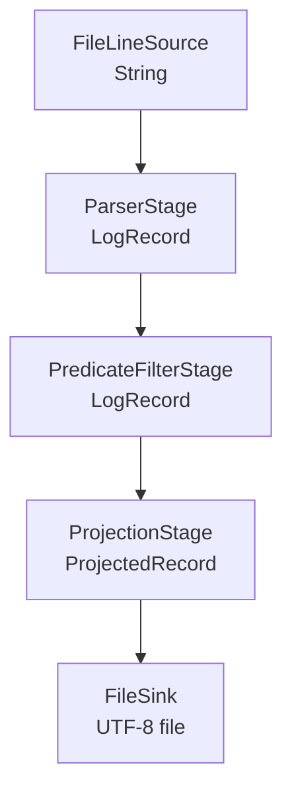

# Mimari

## Pipeline yapısı

Increment 3 ile akış, farklı giriş ve çıkış tiplerine sahip aşamaları tip güvenli
biçimde bağlar. `PipelineBuilder<T>` o anda akan veri tipini taşır; bu nedenle
uyumsuz iki aşama derleme sırasında reddedilir.

`PipelineNode` dahili bağlantıyı temsil eder. Her `via(...)` çağrısı önceki node
ile yeni stage arasında bir `StageNode` oluşturur. `Pipeline.run()` bileşenleri
akış yönünde açar; işlem bittiğinde sink ve aşamaları ters sırada kapatır. Böylece
`FileSink` başarı veya hata durumunda dosya kaynağını serbest bırakır.

## Tek sorumluluk ve bileşebilirlik

- `FileLineSource` yalnızca satır okur.
- `ParserStage` metni immutable `LogRecord` değerine dönüştürür.
- `PredicateFilterStage` yalnızca koşula uyan kayıtları iletir.
- `ProjectionStage` seçilmeyen alanları kaldırarak çıktı boyutunu ve gereksiz veri
  paylaşımını azaltır.
- `FileSink` yalnızca biçimlendirilmiş kaydı dosyaya yazar.
- `Main` iş kuralı uygulamaz; CLI seçeneklerinden pipeline'ı oluşturur.

Bir stage sıfır veya bir çıktı üretebildiği için filtreleme doğal olarak
`Emitter` üzerinden yapılır. Yeni filtreler stage kodu değiştirilmeden lambda
ifadeleriyle eklenebilir.

## Aşama sırası deneyi

Deney, `data/access-small.log` içindeki 200 kayıtla ve şu iki koşulla yapıldı:

1. `status >= 400`
2. `path` değeri `/api` ile başlıyor

Dosyada 20 hata kaydı vardır ve 200 kaydın tamamı `/api` ile başlar.

| Sıra | Status kontrolü | Path kontrolü | Toplam koşul değerlendirmesi | Sonuç |
|---|---:|---:|---:|---:|
| Status, sonra path | 200 | 20 | 220 | 20 kayıt |
| Path, sonra status | 200 | 200 | 400 | 20 kayıt |

Her iki sıra aynı 20 kaydı üretir; ancak seçiciliği yüksek olan status filtresini
önce çalıştırmak 180 koşul değerlendirmesini önler. Sonuç eşitliği `AND`
koşullarının değişme özelliğinden gelir; performans eşit olmak zorunda değildir.

Parser filtreden önce olmak zorundadır, çünkü `status` ve `path` alanları ancak
ayrıştırmadan sonra vardır. Filtreler projection'dan önce tutulur; aksi durumda
filtrenin ihtiyaç duyduğu alan projection tarafından kaldırılmış olabilir.

## Çıktı modeli

`ProjectedRecord`, `LinkedHashMap` kopyasını değiştirilemez olarak saklar. Böylece
CLI'da verilen alan sırası dosyadaki sıraya aynen yansır. Bilinmeyen alan adları
pipeline çalışmadan önce reddedilir.
