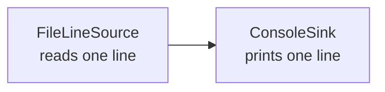

# Architecture

The first increment contains a deliberately small pipeline. A source produces items, the pipeline connects components, and a sink consumes the items.

The `Pipeline` creates the connection between the two components. `Main` only reads the command-line argument, assembles the components, and calls `run()`.

The `Emitter` abstraction is used because one input may produce zero, one, or many output items in later increments. Returning one value from a stage would force an unnecessary one-to-one relationship.
